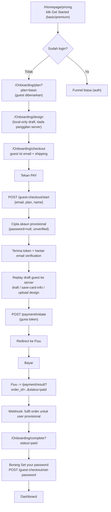
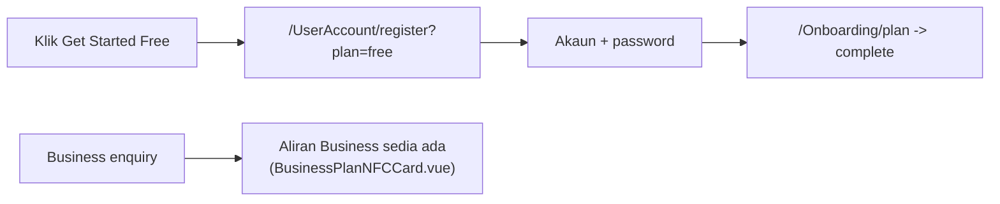

# Guest Checkout — Pelan Pelaksanaan

**Status:** Draf untuk semakan (belum ada kod diubah)
**Tarikh:** 2026-11-25
**Skop:** Benarkan pembeli Basic / Premium bayar **tanpa daftar akaun dulu**, guna model *akaun senyap masa bayar*.

---

## 1. Tujuan & keputusan yang mengikat

Keputusan user (mengikat, jadi asas pelan ini):

| # | Keputusan | Kesan |
|---|-----------|-------|
| D1 | **Akaun senyap masa bayar** | Guest isi email + shipping. Akaun *provisional* (tanpa password) dicipta hanya apabila mereka tekan **Pay**. Selepas bayar, mereka diminta set password. |
| D2 | **Free kekal perlu akaun** | Guest checkout hanya untuk plan **Basic** dan **Premium**. Free trial dan Business kekal ikut daftar akaun biasa. |
| D3 | **Rancang penuh dulu, baru kod** | Dokumen ini disiapkan & diluluskan sebelum sebarang perubahan kod. |

---

## 2. Skop

### Dalam skop
- Guest boleh: pilih plan (Basic/Premium) → design (local) → checkout → bayar → set password → masuk dashboard.
- Akaun provisional dicipta pada saat tekan **Pay**.
- Selepas bayar berjaya, papar borang **"Set your password"** dan log masuk terus.
- Anti-squatting: akaun provisional yang tak pernah bayar boleh dituntut semula.

### Luar skop
- Guest untuk plan **Free** (kekal perlu akaun, D2).
- Guest untuk plan **Business** (aliran Business memang berbeza).
- Guest checkout untuk pengguna yang **sudah** ada akaun (mereka diarah log masuk).
- Mengubah jadual `transactions` / `orders` (tiada migration dijangka).

---

## 3. Sekatan teknikal yang menentukan reka bentuk

Ini fakta yang **sudah disahkan dalam kod**, bukan andaian:

| Sekatan | Bukti | Implikasi |
|---------|-------|-----------|
| `transactions.user_id` **NOT NULL** | [2025_11_14_020001_create_transactions_table.php](file:///c:/Users/USER/Desktop/nfc-Business-card/backend/database/migrations/2025_11_14_020001_create_transactions_table.php#L17) | Mustahil rekod transaksi tanpa user. → **Wajib** cipta akaun sebelum `POST /payment/initiate`. |
| `orders.user_id` **NOT NULL** + FK `cascade` ke `users` | [2026_11_23_000001_create_orders_table.php](file:///c:/Users/USER/Desktop/nfc-Business-card/backend/database/migrations/2026_11_23_000001_create_orders_table.php#L21-L22) | Order juga wajib terikat user. |
| `users.password` **nullable** | [2025_07_28_052221_create_users_table.php](file:///c:/Users/USER/Desktop/nfc-Business-card/backend/database/migrations/2025_07_28_052221_create_users_table.php#L18) | Akaun provisional **tanpa password** memang boleh secara skema. |
| `POST /payment/initiate` guna `auth()->user()` dan ada dalam group `auth:sanctum` | [PaymentController.php](file:///c:/Users/USER/Desktop/nfc-Business-card/backend/app/Http/Controllers/Api/PaymentController.php#L141-L178), [api.php](file:///c:/Users/USER/Desktop/nfc-Business-card/backend/routes/api.php#L158) | Guest mesti ada **token** untuk sampai ke sini. |
| Webhook Fiuu guna `if ($transaction->user)` | [FiuuWebhookController.php](file:///c:/Users/USER/Desktop/nfc-Business-card/backend/app/Http/Controllers/Api/FiuuWebhookController.php) | Selamat: webhook & fulfilment **tidak perlu diubah** selagi user wujud. |
| Return URL Fiuu redirect ke `{frontend}/payment/result?order_id=...&status=...` | [FiuuWebhookController.php](file:///c:/Users/USER/Desktop/nfc-Business-card/backend/app/Http/Controllers/Api/FiuuWebhookController.php#L133-L144) | Guest balik ke `/payment/result` **tanpa auth**. Ini titik sambungan terpenting. |
| Draft onboarding ber-mirror ke server **memerlukan auth** (`GET/PUT /onboarding/draft`) | [useOnboardingFlow.js](file:///c:/Users/USER/Desktop/nfc-Business-card/frontend/composables/useOnboardingFlow.js#L112-L156) | Guest mesti jalan dalam mod **local-only** sehingga akaun wujud. |
| design step tulis ke server: `/onboarding/save-card-info`, `/upload/company-logo`, upload design | [design.vue](file:///c:/Users/USER/Desktop/nfc-Business-card/frontend/pages/Onboarding/design.vue#L799-L940) | Semua panggilan ini **akan 401** untuk guest → perlu di-replay selepas akaun dicipta. |
| Halaman funnel guna `middleware: "auth"` | [plan.vue](file:///c:/Users/USER/Desktop/nfc-Business-card/frontend/pages/Onboarding/plan.vue), [design.vue](file:///c:/Users/USER/Desktop/nfc-Business-card/frontend/pages/Onboarding/design.vue#L586-L588), [checkout.vue](file:///c:/Users/USER/Desktop/nfc-Business-card/frontend/pages/Onboarding/checkout.vue#L599-L602) | Guest akan ditolak di pintu masuk → middleware perlu dilonggarkan secara terkawal. |
| `FreeTrialGuard` hanya diinvoke untuk plan `free` | [OnboardingController.php](file:///c:/Users/USER/Desktop/nfc-Business-card/backend/app/Http/Controllers/Api/OnboardingController.php) | Guest (Basic/Premium) **tidak** menyentuh free-trial guard. Biar begitu. |

**Kesimpulan reka bentuk:** akaun adalah *syarat teknikal* yang tidak boleh dielak. Yang kita ubah hanyalah **bila** ia dicipta dan **apa** yang user nampak — bukan sama ada ia wujud.

---

## 4. Aliran sasaran

### 4.1 Guest (Basic / Premium)



### 4.2 Free & Business (kekal seperti sekarang)



---

## 5. Reka bentuk (backend)

### 5.1 Endpoint baharu

Kedua-duanya **public** (tiada `auth:sanctum`), diletak dalam blok public [api.php](file:///c:/Users/USER/Desktop/nfc-Business-card/backend/routes/api.php) bersama route webhook/legal, dengan throttle.

**`POST /api/guest-checkout/start`**

```
Body:  { email, plan, first_name?, last_name? }
Guard: plan ∈ [basic, premium]   (selain itu → 422)
       throttle:guest-start (mis. 5/min per IP)
```

Kelakuan:
1. Normalisasi email (guna `EmailNormalizer` sedia ada).
2. Kalau sudah ada akaun **bukan-provisional** → `409 { code: "ACCOUNT_EXISTS" }`; frontend arah ke log masuk.
3. Kalau ada akaun **provisional terbengkalai** (lihat §5.2) → guna semula rekod itu.
4. Cipta user: `first_name`, `last_name`, `email`, `password = null`, `provider = null`, `is_new_user = true`, `email_verified_at = null`, `settings.guest_checkout = true`.
5. Hantar email verification (`sendEmailVerificationNotification()`), sama seperti daftar biasa.
6. Pulangkan `{ token, user, needs_password_setup: true }`.

**`POST /api/guest-checkout/set-password`** — `auth:sanctum`

```
Body:  { password, password_confirmation }
Guard: hanya bila user semasa adalah provisional (password IS NULL)
       regex sama seperti register (1 besar, 1 kecil, 1 digit, 1 simbol)
```

Kelakuan: set `password = Hash::make(...)`; buang flag provisional. **Tidak** menandakan email sebagai verified — pengesahan tetap ikut email verification link.

> **Kenapa bukan guna `PasswordResetController` sedia ada?** Ia memerlukan token yang dihantar melalui email (round-trip email). Guest sedang berada di halaman selepas bayar; token sesi yang sudah dipegang pelayar itu adalah bukti identiti yang setara dengan daftar biasa. Jika round-trip email mahu dikurangkan lagi, ia boleh jadi pilihan alternatif (lihat §11).

### 5.2 Definisi "provisional" & "boleh dituntut semula"

Kena ada satu definisi tunggal supaya `register()` dan `guest-checkout/start` tidak bercanggah:

```
provisional  := password IS NULL
                AND provider IS NULL
                AND subscription_active = false
                AND tidak pernah ada transaksi status succeeded
```

- **Akaun provisional terbengkalai** (contoh > 24 jam, tiada bayaran) → **boleh dituntut**: `register()` menimpa password & nama (corak sama seperti `reactivateAccount()` sedia ada di [AuthController.php](file:///c:/Users/USER/Desktop/nfc-Business-card/backend/app/Http/Controllers/Api/AuthController.php#L156-L179)), supaya pemilik email sebenar tidak "terkunci" gara-gara guest lain taip emailnya.
- Akaun provisional yang **sudah dibayar** → akaun biasa, dilindungi penuh (tak boleh dituntut).

> Ini menutup lubang squatting: email yang sekadar dicemari oleh orang lain akan bebas semula selepas tempoh grace.

### 5.3 Task pembersihan (scheduled)

Job baru (bukan ubah yang lama): padam akaun provisional yang **tiada** transaksi `succeeded` dan dicipta > **48 jam**. Ini had paling murah untuk elak `users` membengkak dengan checkout terbengkalai.

### 5.4 Perubahan pada `register()`

Tambah satu cabang: jika email wujud dan akaun itu **provisional** (§5.2) → layan seperti boleh dituntut (tulis ganti), bukan `"email already registered"`. Ini perubahan kecil & tertutup.

### 5.5 Perubahan pada middleware

Tiada perubahan pada [EnsureEmailIsVerifiedWithGrace.php](file:///c:/Users/USER/Desktop/nfc-Business-card/backend/app/Http/Middleware/EnsureEmailIsVerifiedWithGrace.php) diperlukan: guest provisional yang baru dicipta masih dalam tempoh grace 7 hari, jadi `/payment/initiate` dan `/onboarding/*` boleh dicapai. **Risiko** hanya jika guest lambat bayar > 7 hari — ditangani di §7.

---

## 6. Reka bentuk (frontend)

### 6.1 Middleware akses funnel

Tambah middleware baharu `onboarding-access` (ganti `auth` pada 3 halaman funnel):

- **Sudah login** → lulus (tingkah laku sekarang).
- **Guest + `?plan=` basic/premium** (atau draft plan basic/premium) → lulus.
- **Guest + free/business/tanpa plan** → redirect ke `/UserAccount/register` (kekal perlu akaun, D2).

Fail terlibat: [plan.vue](file:///c:/Users/USER/Desktop/nfc-Business-card/frontend/pages/Onboarding/plan.vue), [design.vue](file:///c:/Users/USER/Desktop/nfc-Business-card/frontend/pages/Onboarding/design.vue#L586-L588), [checkout.vue](file:///c:/Users/USER/Desktop/nfc-Business-card/frontend/pages/Onboarding/checkout.vue#L599-L602).

### 6.2 Mod local-only untuk guest

Dalam [useOnboardingFlow.js](file:///c:/Users/USER/Desktop/nfc-Business-card/frontend/composables/useOnboardingFlow.js), semua panggilan `$api` draft (`GET/PUT/DELETE /onboarding/draft`) mesti **dilangkau** apabila `authStore.isAuthenticated === false`. Draft kekal di `sessionStorage` (sudah ada) supaya refresh tak hilang.

Tambah satu fungsi baharu: `flushDraftToServer()` — dipanggil **sekali** selepas token guest diperoleh, untuk:
1. `PUT /onboarding/draft` (plan + cardInfo + cardDesign + selectedTemplate + designMethod + shipping)
2. `POST /onboarding/save-card-info`
3. Upload logo/design jika ada fail tertunda

### 6.3 Checkout — cipta akaun masa Pay

Dalam [checkout.vue](file:///c:/Users/USER/Desktop/nfc-Business-card/frontend/pages/Onboarding/checkout.vue):

- Tambah medan **Email** pada blok Shipping Address (kini tiada; hanya nama/telefon/alamat).
- Sebelum komponen bayaran menghantar permintaan:
  1. Jika sudah login → teruskan seperti biasa.
  2. Jika guest → `POST /guest-checkout/start` → simpan token (localStorage) → set `authStore` → `flushDraftToServer()` → barulah bayar.
  3. Jika respons `ACCOUNT_EXISTS` → papar "Email ini sudah berdaftar. Sila log masuk." + pautan log masuk (kekalkan draft supaya tak hilang).
- `orderMetadata` sedia ada ([checkout.vue](file:///c:/Users/USER/Desktop/nfc-Business-card/frontend/pages/Onboarding/checkout.vue#L719-L737)) sudah bawa `billing_address` → `orders` shipping. Tiada perubahan skema.

### 6.4 Selepas bayar

- Fiuu → `/payment/result` ([result.vue](file:///c:/Users/USER/Desktop/nfc-Business-card/frontend/pages/payment/result.vue)): sebab token guest disimpan, halaman ini boleh sahkan identiti dan terus ke `/Onboarding/complete`.
- `/Onboarding/complete`: jika `needs_password_setup` → papar borang **Set your password** → `POST /guest-checkout/set-password` → terus masuk dashboard.
- Bersihkan token guest dari localStorage selepas password ditetapkan.

---

## 7. Keselamatan & anti-abuse

| Risiko | Mitigasi |
|--------|----------|
| **Squatting email** — orang lain taip email mangsa → mangsa tak boleh daftar. | §5.2 (provisional terbengkalai boleh dituntut) + §5.3 (auto-delete 48 jam) + email verification dihantar segera. |
| **Email palsu** → susah nak hantar kad & susah dihubungi. | Akaun kekal `email_verified_at = null`; jadikan **verifikasi email sebagai syarat sebelum card dihantar** (keputusan di §11). Order tetap direkod & dibayar. |
| **Spam akaun provisional** | `throttle:guest-start` per IP + had jumlah provisional per IP/jam + cleanup job. |
| **Bayaran lambat > 7 hari** (grace tamat → guest tersekat di tengah jalan). | Manual bank transfer dihadkan masa; papar amaran; jika perlu, `guest-checkout/*` ditambah ke `$except` grace middleware. |
| **Guest cuba ambil Free secara curang** | `guest-checkout/start` tolak `plan=free` (422). Free tetap lalu `/UserAccount/register`. |
| Akaun provisional muncul dalam senarai admin / analitik. | Guna `settings.guest_checkout = true` + skop/flag untuk tapis; nyatakan dalam UI admin. |

---

## 8. Kesan pada sistem sedia ada

| Bahagian | Kesan |
|----------|-------|
| `transactions` / `orders` | **Tiada perubahan skema.** |
| Webhook & `OrderFulfilmentService` | **Tiada perubahan** — user sentiasa wujud. |
| Aliran berdaftar (Free/Business) | Tidak berubah, kecuali `register()` ditambah cabang "provisional boleh dituntut". |
| Notifikasi pendaftaran | Akaun provisional patut **tidak** hantar "registration success" penuh; hantar versi selamat datang + pautan set password (perlu keputusan, §11). |
| Analytics / audit | Akaun provisional perlu ditanda supaya metrik "user berdaftar" tidak menggelembung. |

---

## 9. Pelan ujian

**Backend (Pest):**
1. `guest-checkout/start` + `plan=free` → 422.
2. `guest-checkout/start` email sedia ada (akaun sebenar) → 409 `ACCOUNT_EXISTS`.
3. `guest-checkout/start` dua kali dengan email sama → rekod sama diguna semula, tiada duplikasi.
4. `register()` dengan email provisional terbengkalai → berjaya ganti (claim).
5. `guest-checkout/set-password` tanpa token → 401; dengan password lemah → 422; dengan password sah → berjaya, `password` tidak lagi null.
6. `POST /payment/initiate` dengan token guest → transaksi + order tercipta dengan `user_id` betul.
7. Webhook `succeeded` → order fulfilled, `is_new_user=false`.
8. Cleanup job padam provisional > 48 jam yang tiada bayaran; **tidak** padam yang sudah bayar.

**Manual (E2E):** Guest pilih Premium → design → checkout (isi email/shipping) → Pay (Fiuu sandbox) → return → set password → dashboard, dan sahkan kad/plan betul pada akaun itu.

---

## 10. Fasa pelaksanaan

**Fasa 1 — Backend (boleh diuji sendiri)**
1. `GuestCheckoutController` dengan `start` + `set-password`.
2. Route public + throttle; helper `isProvisional()` pada model `User`.
3. Cabang "provisional boleh dituntut" dalam `AuthController::register()`.
4. Cleanup job + daftar dalam scheduler.
5. Ujian Pest (§9).

**Fasa 2 — Frontend**
6. Middleware `onboarding-access` + pasang pada 3 halaman funnel.
7. `useOnboardingFlow`: skip server draft untuk guest + `flushDraftToServer()`.
8. `checkout.vue`: medan email + panggilan `guest-checkout/start` sebelum bayar + handling `ACCOUNT_EXISTS`.
9. `complete.vue`: borang "Set your password".
10. `payment/result.vue`: laluan guest → `/Onboarding/complete`.

**Fasa 3 — Verifikasi**
11. E2E sandbox Fiuu + audit kesan admin (senarai user / analitik).

---

## 11. Keputusan terbuka (perlu jawapan sebelum Fasa 1)

1. **Verifikasi email sebagai syarat penghantaran kad?** (a) Ya — kad hanya dihantar selepas email verified; (b) Tidak — hantar sahaja, verifikasi hanya untuk akses akaun.
2. **Notifikasi untuk akaun provisional:** hantar email "Welcome + set your password" penuh, atau versi minimum sahaja?
3. **Titik cipta akaun:** kekal **masa Pay** (ikut D1), atau tukar ke **masa masuk checkout** supaya upload design tak perlu ditahan dalam pelayar? (Masa Pay = lebih bersih secara konsep; Masa masuk checkout = kurang kod & risiko.)
4. **Nota belum selesai dari sesi lepas:** `/payment/result` masih land ke `/UserDashboard` gaya lama — selaraskan ke `/Onboarding/complete` dalam kerja ini juga?

---

*Dokumen ini belum diikuti sebarang perubahan kod. Selepas diluluskan, pelaksanaan bermula pada Fasa 1.*
